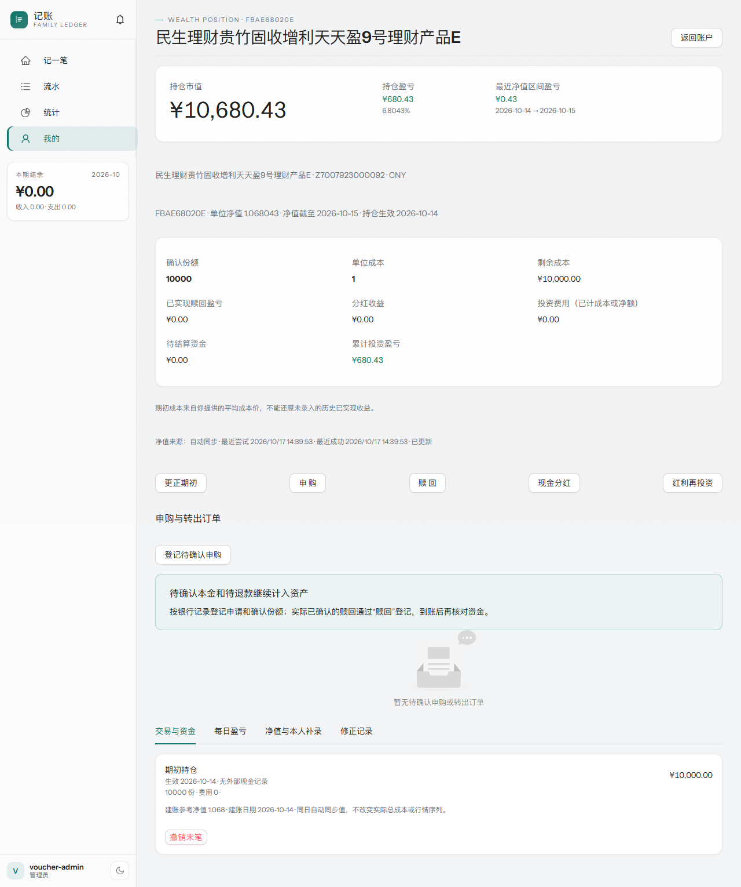
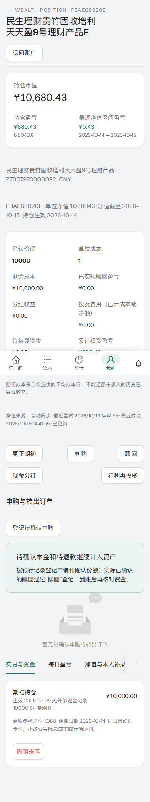

# 民生天天盈9号E份额接入与验收

日期：2026-10-16。用户明确要求新增 E 份额并复用定时同步、自动净值及持仓收益；本次完成本地代码和隔离验收，未部署生产，未迁移真实开发或生产账本。既有苏银三天采样任务 1.4、8.4 的未完成状态保持。

## 产品身份与迁移

- 发行人/来源：`cmbcwm`；份额：`FBAE68020E`；登记编码：`Z7007923000092`；人民币单位净值；产品成立日 2023-06-20。不加入 A 份额或仅按主产品/登记编码建仓。
- 追加 `000020_cmbcwm_wealth_product.up.sql`，只插入公共产品目录，`enabled` 与 `user-approved-cmbcwm-http-20261016` 明确记录本次用户要求，不声明多日采样通过，不创建个人账户、份额、价格或资金记录。
- `down` 在该产品存在持仓或本人补值引用时先拒绝，再考虑删除公共缓存；有个人历史采用保留结构的前向修复。独立 MySQL 库已验证公共数据 up/down/up 及有个人引用拒绝 down，苏银原目录不变。

## 实现

- `backend/internal/wealthdata` 提供共享净值类型、受控目录和来源分派，苏银原类型保留别名。仓储按发行人、登记编码、份额、币种、适配器和来源代码精确匹配，不能借另一来源的相同代码匹配持仓。
- `backend/internal/cmbcwm` 匿名表单 POST 至官网固定 HTTPS 地址：先核对 `BTAProductQry` 身份，再用 `BTADailyQry` 每页 100 条读取完整历史。请求 15 秒超时、禁止重定向、限制响应体/分页/总条数，整批核验成功后才返回；采用十进制解析，拒绝非正/非有限/超精度/未来值、重复日期、分页缺失和业务失败，不将万份收益/七日年化占位零用于估值。
- 继续使用现有 `Ensure`、北京时间 08/12/18/22 四槽、启动合并恢复、产品租约、60 秒冷却和错误退避。民生按具体产品检查配置，不依赖苏银采集器 URL 或密钥；每次取完整历史，以保留对旧日期修订的检查能力，不新增高频定时任务。
- 自动值写入原有公共净值与版本表，重估相关账号持仓/历史并失效账户、首页和统计缓存。无新值不重记收益；失败保留旧数据；任何行情更新都不写现金或份额事实。
- 周利宝甲乙丙转出申请及预览限定 J07241；民生继续使用真实已确认赎回、到账及通用待确认申购。界面按产品展示，民生不出现苏银专用分配说明。准入证据也必须与目标份额对应，不能交叉使用。

## 真实公开来源验证

Go 适配器实测无登录、Cookie、API Key 或浏览器依赖，完整返回 **754** 条 E 份额记录：最早 **2023-08-30**，最新 **2026-10-15**，单位净值 **1.068033**。[官网产品页](https://www.cmbcwm.com.cn/cmbcwm/grlc/cpxq/index.html?code=FBAE68020E)

真实数据进一步经过 `Ensure → SavePublicNAVs → RebuildPosition` 存入隔离内存账本：测试持仓 10000 份、成本 10000 元，市值 10680.33 元、持仓盈亏 680.33 元、相邻净值区间盈亏 0.33 元；现金仍为原测试余额。此为测试向量，不是用户真实持仓或收益。

## 验证结果

| 检查 | 结果 |
|---|---|
| `CMBCWM_LIVE_TEST=1 go test ./internal/cmbcwm -run '^TestLiveAnonymousHistory$' -count=1 -v` | 通过，匿名完整分页 754 条 |
| `CMBCWM_LIVE_TEST=1 go test ./internal/service -run '^TestWealthCmbcwmLiveHTTPValuation$\|^TestWealthAdmissionEvidenceCannotCrossShareClasses$' -count=1 -v` | 通过，真实源至隔离持仓估值、证据份额隔离 |
| `go test ./internal/service -run 'TestWealthCmbcwm' -count=1 -v` | 通过；四槽、两账号重估、重复同步、修订、失败保留、配置独立、通用申购及实际赎回 |
| 私有 `WEALTH_MYSQL_DSN` 下 `go test ./internal/service -run '^TestWealthMySQLCmbcwmCatalogMigrationAndRollbackGuard$' -count=1 -v` | 通过，随机数据库，up/down/up 和个人引用保护；测试结束清理 |
| `go test ./...`、`go vet ./...`、`go build ./cmd/server` | 通过；编译产物输出到忽略的 `bin/jizhang-cmbcwm-test.exe` |
| `npm run typecheck`、`npm run test:unit`、`npm run build` | 通过；28 个测试文件、88 个单元测试；构建仍有既有大 chunk 提示 |
| `node e2e/wealth-cmbcwm.mjs`，桌面 1280px / 手机 360px | 通过，选择 E 份额、登记持仓、自动服务重估、修订不改份额成本、失败保留、无横向溢出 |
| `node e2e/wealth-orders.mjs`，桌面 / 手机 | 通过，各 18 个断言；苏银申购/确认/退款及转出分配保持 |
| `openspec validate add-bank-wealth-accounts --strict`、`git diff --check` | 通过 |

原有苏银桌面验收中的键盘填日期有时尚未提交表单值，导致交易日断言失败；验收脚本改用控件日历选择，桌面和手机都通过，业务日期逻辑未修改。民生的浏览器验收使用同样的日历交互。

界面验收使用本地 loopback 内存 fixture，不使用真实财务数据库。截图中的 `1.068043` 为模拟同日修订，用于证明 10000 份持仓市值增加 0.10 元、区间盈亏从 0.33 改为 0.43 元；它不是官方最新净值。

## 运行与发布

应用部署时按既有备份/迁移流程执行至 `000020`，同时更新后端和前端。民生无需新环境变量；苏银保留原 `WEALTH_COLLECTOR_*`。迁移完成后从银行理财账户选择 E 份额录入本人实际持仓，后台在现有检查点自动同步，也可手动刷新。此文不表示生产迁移已执行；生产连通性与跨日采样尚未验证。
